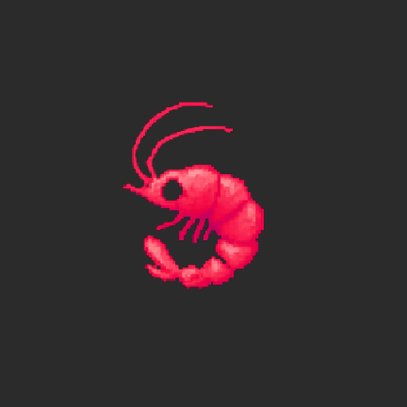
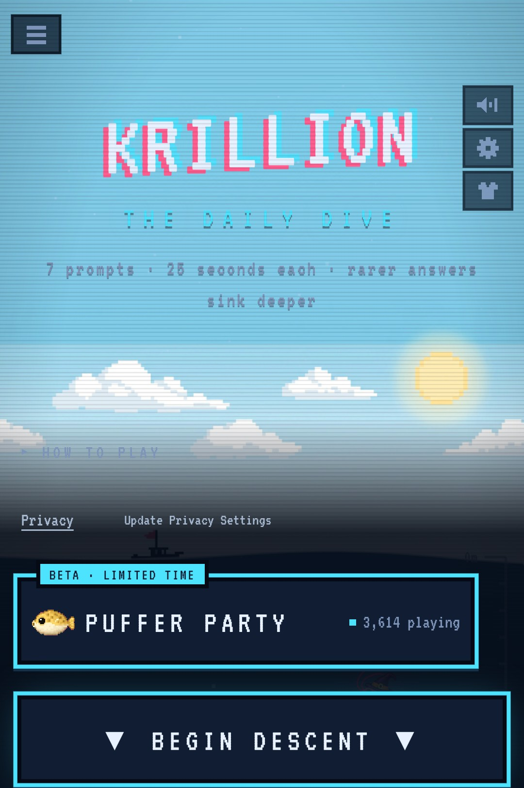

<!-- Generated from readme.yml by LukeNeedham/ci-workflows (docs/readme.md). Edit readme.yml, not this file. -->
<p align="center">
  
</p>

# Krillion wrapper

Krillion in a full-screen Android app.

## Description

Krillion wrapper is a minimal Android app that wraps the web game [Krillion](https://krillion.io/) in a full-screen
`WebView`, so it plays like an app. It is portrait only, keeps the screen on while you play, and keeps your game
saves and cookies between launches.

## Screenshots



## Getting started as a user

1. Install the latest build from the [AppHub](https://www.lukeneedham.com/apphub) app, or download the APK from the [Releases](https://github.com/LukeNeedham/krillion-wrapper/releases) page.

Requires Android 8.0 (API 26) or newer.

## Getting started as a developer

Requirements: JDK 17 and the Android SDK (platform 36), for example through Android Studio.

```
git clone https://github.com/LukeNeedham/krillion-wrapper.git
cd krillion-wrapper
./gradlew assembleDebug    # the APK is in app/build/outputs/apk/debug/
./gradlew test             # unit tests
```

Every pull request is built by CI, which comments on it with a link to install the APK.

Like all my apps, it follows the shared architecture and conventions (single activity, Jetpack Compose, Navigation 3, MVVM with every page split into a `Page` and a `PageContent`, Koin): see [ci-workflows](https://github.com/LukeNeedham/ci-workflows/blob/main/docs/new-app.md).

- Game URL and host: `GAME_URL` and `GAME_HOST` in `MainActivity.kt`.
- Icon: `res/drawable-nodpi/ic_launcher_foreground.png` (the Krillion shrimp, 432×432, kept inside the
  adaptive-icon safe zone) on the dark grey `icon_background` colour in `res/values/colors.xml`.

## Contributing

Branch from `main`, make the change, and open a pull request. CI must be green before it is merged.

## License

All rights reserved. See [LICENSE](LICENSE).
